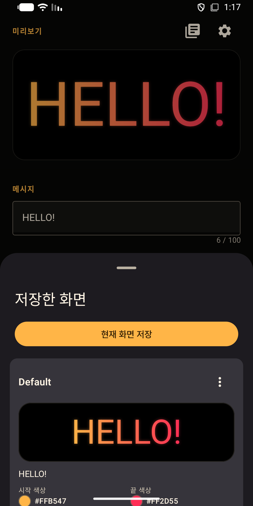
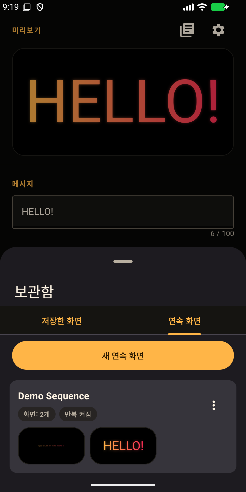
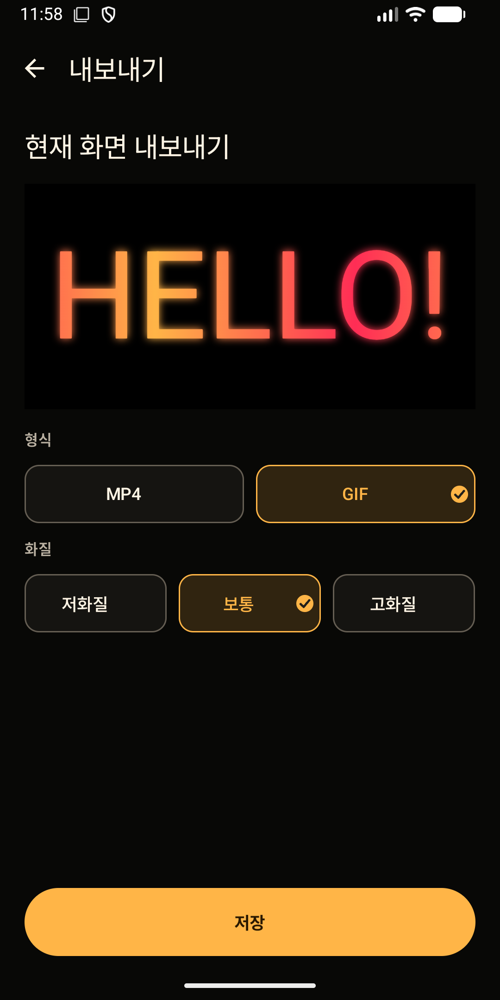

# LEDgram

[English](README.md)

LEDgram은 Android 스마트폰, 태블릿, 폴더블 기기를 밝고 자유롭게 꾸밀 수 있는 LED 전광판으로 바꾸는 앱입니다. Editor에서 문구를 만들고 즉시 미리 본 뒤, 행사·응원·안내 또는 일상적인 소통을 위해 전체 화면으로 표시할 수 있습니다.

## 주요 기능

- 단색 글자·배경 색상과 6가지 고정 및 4가지 애니메이션 글자 그라데이션, 독립적인 그라데이션 속도
- 굵게, 기울임, 밑줄 글자 스타일
- Text + Glow 및 Dot Matrix 표현 방식
- 고정 문구 또는 양방향 전광판 이동
- Blink, Pulse, Fade 효과와 독립적인 이동·효과 속도 조절
- 소프트 줄바꿈 없이 한글을 포함한 명시적 여러 줄 입력
- 스마트폰, 태블릿, 폴더블 기기에서 부드러운 화면 방향 추적과 Lock/Unlock을 지원하는 몰입형 전체 화면 Display
- 앱을 다시 실행해도 유지되는 Editor 설정
- 미리보기와 상세 정보, 저장, 불러오기, 이름 변경, 격리된 직접 편집, 명시적 업데이트, 삭제, 불러오기 실행 취소 및 편집 가능한 초기 Default 화면을 지원하는 저장한 화면 목록
- 저장한 LED 화면의 독립적인 복사본을 순서대로 재생하고 개별 편집, 순서 저장, 반복, 재생 시간, 일시정지/재생 및 Lock을 지원하는 연속 화면
- 현재 Editor 화면, 저장한 화면 및 연속 화면을 기기에서 로컬로 MP4나 GIF로 만들고 계속 갱신되는 내보내기 미리보기, 화질 선택, 진행 상태, 취소, MediaStore 저장 및 Android Sharesheet 공유를 지원하는 내보내기
- 새로 설치하면 Brand Amber에서 Pink로 이어지는 고정 가로 그라데이션으로 시작하며, 기존에 저장된 Editor 설정과 저장한 화면은 변경되지 않음
- 시스템 기본값과 앱에서 직접 선택 가능한 14개 언어: 영어, 한국어, 일본어, 중국어 간체, 스페인어(스페인), 스페인어(라틴 아메리카), 포르투갈어(브라질), 프랑스어, 독일어, 이탈리아어, 인도네시아어, 베트남어, 태국어, 아랍어 및 아랍어 오른쪽에서 왼쪽으로 쓰기(RTL) 지원
- 광고 없이 표시되는 전체 화면 Display와 계정·로그인 없이 바로 사용할 수 있는 구성
- 필요한 지역에서 UMP 동의 및 개인정보 보호 옵션을 제공하며 맞춤형 광고 요청을 비활성화한 Google Mobile Ads

## 스크린샷

### Editor와 실시간 미리보기

### 그라데이션 패턴

### 저장한 화면

### 이동 및 시각 효과

### Text + Glow Display

### Dot Matrix Display

### 연속 화면

### 내보내기

## 기술 구성

- Kotlin 2.4.21
- Jetpack Compose(BOM 2025.11.00) 및 Material 3
- AndroidX DataStore 1.2.1 및 Android SDK 24–36
- AndroidX Core 1.18.0, Activity Compose 1.13.0 및 AppCompat 1.8.0
- Google Mobile Ads 25.5.0 및 UMP 4.0.0
- Kotlin DSL 기반 Android Gradle Plugin 9.4.1 및 Gradle 9.8.0

## 출시 상태

- **전체 출시를 위해 제출한 최신 버전:** 1.5.3 / 32. 출시가 시작되었으며 완료 여부는 독립적으로 확인되지 않았습니다.
- **1.5.3:** UMP 동의 기능은 유지하면서 맞춤형 광고 요청을 전역적으로 비활성화했습니다.
- **1.5.2:** Edge-to-Edge 적용 방식과 AndroidX 의존성을 업데이트하고, 키보드 위에 사용자 지정 색상 버튼이 표시되도록 수정했으며, 문의 이메일을 변경했습니다. Google Play의 Edge-to-Edge 권고는 계속 검토 중입니다.
- **설치:** [Google Play에서 LEDgram 설치하기](https://play.google.com/store/apps/details?id=com.gwolbisa.ledgram)

## 개발자

LEDgram은 **Gwol Labs**에서 개발합니다.

문의: [contact@gwollabs.dev](mailto:contact@gwollabs.dev)

## 저장소 범위

LEDgram 공개 문서와 Google Play 스토어 자료는 [`Chiffon95/ledgram-public`](https://github.com/Chiffon95/ledgram-public)에 게시합니다. Android 애플리케이션 소스 코드는 비공개로 관리합니다.

## 링크

- [공식 웹사이트](https://gwollabs.dev/apps/ledgram/)
- [개인정보 처리방침 — 영어](https://gwollabs.dev/apps/ledgram/privacy/)
- [개인정보 처리방침 — 한국어](https://gwollabs.dev/apps/ledgram/privacy/ko.html)

## 라이선스

이 프로젝트에는 오픈 소스 라이선스가 공개되어 있지 않습니다. 모든 권리는 Gwol Labs에 있습니다.

LEDgram에는 Lee Minseo가 제작하고 SIL Open Font License 1.1로 배포한 [Galmuri11](https://github.com/quiple/galmuri)이 포함됩니다. OFL은 번들 글꼴에만 적용되며 LEDgram 애플리케이션 소스 코드에는 적용되지 않습니다.
