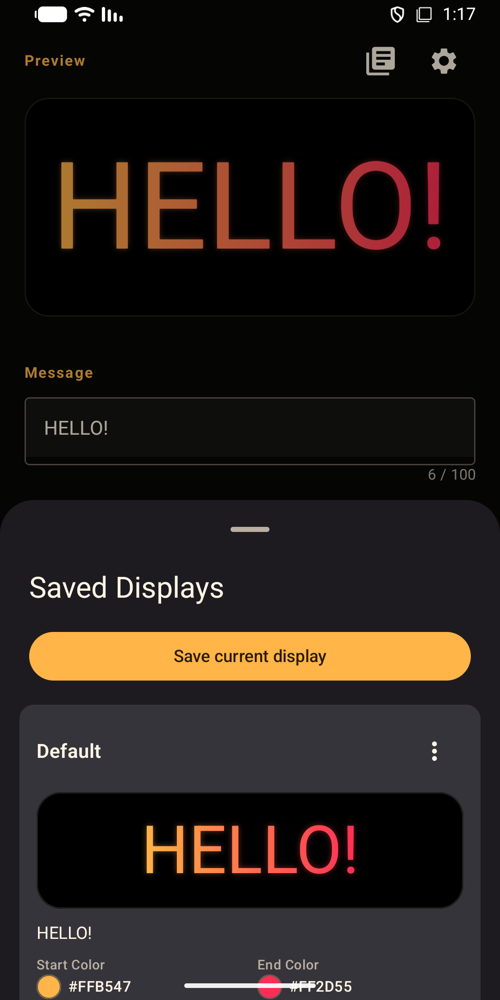
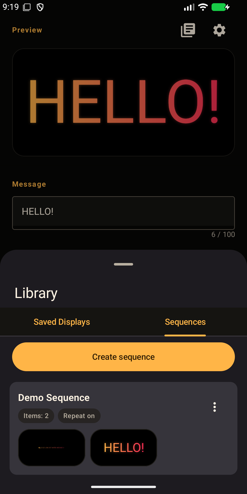
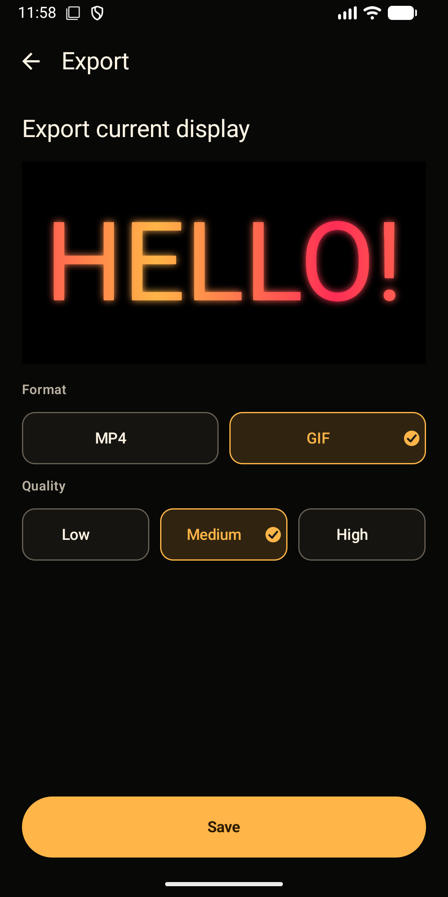

# LEDgram

[한국어](README.ko.md)

LEDgram turns an Android phone, tablet, or foldable into a bright, customizable LED message display. Create a message in the Editor, preview it instantly, and show it full-screen for events, cheering, announcements, or everyday communication.

## Highlights

- Solid text and background colors plus six static and four animated text gradient patterns with independent gradient speed
- Bold, italic, and underline text styles
- Text + Glow and Dot Matrix display styles
- Static text or marquee motion in either direction
- Blink, Pulse, and Fade effects with independent motion and effect speeds
- Explicit multiline input without soft wrapping, including Hangul text
- Immersive full-screen Display with smooth orientation following and Lock/Unlock controls on phones, tablets, and foldables
- Editor settings preserved between sessions
- Saved Displays library with previews, details, save, load, rename, direct isolated editing, explicit update, delete, load Undo, and an editable initial Default display
- Sequences that play independent copies of saved LED displays in order, with item editing, persistent reordering, repeat, playback timing, Pause/Resume, and Lock integration
- Local MP4 and GIF export for the current Editor display, Saved Displays, and Sequences, with a continuously updating Export preview, quality options, progress, cancellation, MediaStore saving, and sharing through the Android Sharesheet
- New installations start with a static horizontal Brand Amber-to-Pink gradient; existing saved Editor configurations and saved displays remain unchanged
- System Default plus 14 bundled selectable languages: English, Korean, Japanese, Simplified Chinese, Spanish (Spain), Spanish (Latin America), Portuguese (Brazil), French, German, Italian, Indonesian, Vietnamese, Thai, and Arabic with right-to-left layout support
- Full-screen Display without ads and no account or login requirement
- Google Mobile Ads with UMP consent and privacy options where applicable; ad requests disable personalization

## Screenshots

### Editor overview

### Gradient patterns

### Saved Displays

### Motion and effects

### Text + Glow display

### Dot Matrix display

### Sequences

### Export

## Technology

- Kotlin 2.4.21
- Jetpack Compose (BOM 2025.11.00) and Material 3
- AndroidX DataStore 1.2.1 and Android SDK 24–36
- AndroidX Core 1.18.0, Activity Compose 1.13.0, and AppCompat 1.8.0
- Google Mobile Ads 25.5.0 and UMP 4.0.0
- Android Gradle Plugin 9.4.1 and Gradle 9.8.0 with Kotlin DSL

## Release status

- **Latest version submitted for full rollout:** 1.5.3 / 32. Rollout has started; completion has not been independently verified.
- **1.5.3:** Disabled personalized ad requests globally while retaining UMP consent.
- **1.5.2:** Updated edge-to-edge integration and AndroidX dependencies, kept Custom Color actions visible above the keyboard, and updated the support email. Google Play edge-to-edge recommendations remain under review.
- **Install:** [Get LEDgram on Google Play](https://play.google.com/store/apps/details?id=com.gwolbisa.ledgram)

## Developer

LEDgram is developed by **Gwol Labs**.

Support: [contact@gwollabs.dev](mailto:contact@gwollabs.dev)

## Repository scope

Public LEDgram documentation and Google Play store assets are published in [`Chiffon95/ledgram-public`](https://github.com/Chiffon95/ledgram-public). The Android application source code is maintained privately.

## Links

- [Official website](https://gwollabs.dev/apps/ledgram/)
- [Privacy Policy — English](https://gwollabs.dev/apps/ledgram/privacy/)
- [Privacy Policy — Korean](https://gwollabs.dev/apps/ledgram/privacy/ko.html)

## License

No open-source license has been published for this project. All rights are reserved by Gwol Labs.

LEDgram bundles [Galmuri11](https://github.com/quiple/galmuri) by Lee Minseo under the SIL Open Font License 1.1. The OFL applies to the bundled font, not to LEDgram's application source code.
